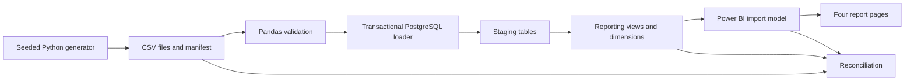

# Digital Wallet BI & Reporting

**Synthetic data.** A fintech BI portfolio project using Python, Pandas, PostgreSQL, SQL, DAX and Power BI Desktop.

## Final report

Open **[powerbi/Wallet.pbip](powerbi/Wallet.pbip)**. This is the single final project.

| Page | Purpose |
| --- | --- |
| Executive overview | Successful value, net wallet fees, failure rate and service mix |
| Transaction operations | Failed/pending attempts and reversals by month/service |
| Customers | Active senders and recipients, and next-month activity retention |
| Merchants & agents | Partner activity, value and wallet fees |

All pages use synthetic data for October 2025–September 2026, UTC, in AED. Net fees are not profit; costs are not modeled. The model cache is excluded from Git, so reproduce the database and Refresh after cloning.

## Architecture



## Reproduce on Windows

Prerequisites: Python 3.12, PostgreSQL 18, Power BI Desktop and Git. Docker is not required.

```powershell
python -m venv .venv
.\.venv\Scripts\python.exe -m pip install -r requirements.txt
.\.venv\Scripts\python.exe src/generate.py --customers 1000 --transactions 10000 --seed 42 --as-of 2026-10-25
.\.venv\Scripts\python.exe -m unittest discover -s tests -v
```

The generator preserves existing output; choose a new `--output` directory to repeat generation. Pin `--as-of` for reproducibility.

In pgAdmin, create a login role `wallet_bi` and an empty database **`digital_wallet_b`** owned by it. Then run:

```powershell
.\.venv\Scripts\python.exe src/load.py --validate-only
.\.venv\Scripts\python.exe src/load.py
.\.venv\Scripts\python.exe src/load.py
```

Enter the password privately at the prompt. Defaults are `127.0.0.1:5432`, database `digital_wallet_b`, user `wallet_bi`. The first run reports `loaded`; the second reports `already_loaded` without duplicates.

Run [sql/006_power_bi_dimensions.sql](sql/006_power_bi_dimensions.sql) in pgAdmin. Open `powerbi/Wallet.pbip`, enter the database credentials when prompted and select **Refresh**. Relationships, measures and visuals are already defined. If using another host/database, also update the Power Query connection.

## Results

Seed 42 produces 1,000 customers, 60 merchants, 30 agents and 10,000 attempts. All identifiers are fictional; money is stored as integer fils (100 fils = AED 1).

| Metric | Result |
| --- | ---: |
| Successful / failed / pending attempts | 9,185 / 608 / 207 |
| Full reversals | 232 |
| Failure rate | 6.08% |
| Gross successful value | AED 9,215,598.99 |
| Reversed value | AED 233,451.40 |
| Net transaction value | AED 8,982,147.59 |
| Gross fees / fee refunds | AED 40,376.32 / 1,065.76 |
| Net fee revenue | AED 39,310.56 |
| October to November activity retention | 62.94% |

These are outputs of simulation assumptions, not discoveries about real customers.

## Verification

The saved dataset passes 57 quality checks. The loader validates every persisted field and reconciles aggregate totals before committing. The first load and duplicate-free rerun were verified locally. Live Power BI exports matched **432 integer comparisons** across 48 month/service groups; customer activity/retention matched for all 12 months.

```powershell
.\.venv\Scripts\python.exe src/reconcile.py
```

This compares generated CSVs against the checked-in aggregate Power BI snapshot. For a fresh direct SQL-to-Power-BI comparison, export [007_sql_reconciliation.sql](sql/007_sql_reconciliation.sql) from pgAdmin and [008_powerbi_reconciliation.dax](sql/008_powerbi_reconciliation.dax) from Power BI DAX Query View, then run:

```powershell
.\.venv\Scripts\python.exe src/reconcile.py --sql-csv data/sql_export.csv --powerbi-csv data/powerbi_export.csv
```

## Important design decisions

- Each transfer counts once, while both customers can count as active.
- Failed/pending requested amounts do not become successful value or fee revenue.
- Full reversals preserve original successes and deduct value/fees on reversal dates.
- Retention looks from month M to M+1; the final month returns blank, not zero.
- One immutable dataset per database; conflicting datasets are rejected.
- PostgreSQL reporting objects are views, imported into a Power BI star schema.
- Balances, settlement, double-entry accounting, acquisition cohorts and costs are outside scope.

## Repository

| Folder | Contents |
| --- | --- |
| `src/` | Generator, loader, reconciliation and report builders |
| `sql/` | Schema, reporting queries, dimensions and reconciliation |
| `tests/` | Correctness, corruption, reconciliation and report checks |
| `powerbi/` | Final report and semantic-model source |
| `docs/` | Requirements, KPIs, data model, findings and validation evidence |

Read the [requirements](docs/business_requirements.md), [KPI dictionary](docs/kpi_dictionary.md), [data model](docs/data_model.md), [findings](docs/management_findings.md) and [verification notes](docs/verification.md).

To recreate the four default layouts, close Desktop and run `python src/build_report.py`. It replaces generated layouts and creates an ignored local backup. Edit the PBIP directly in Desktop for normal report work.

Generated data, virtual environments, caches, local settings, backups and secrets are excluded from Git. No publication or company-database connection is required.
